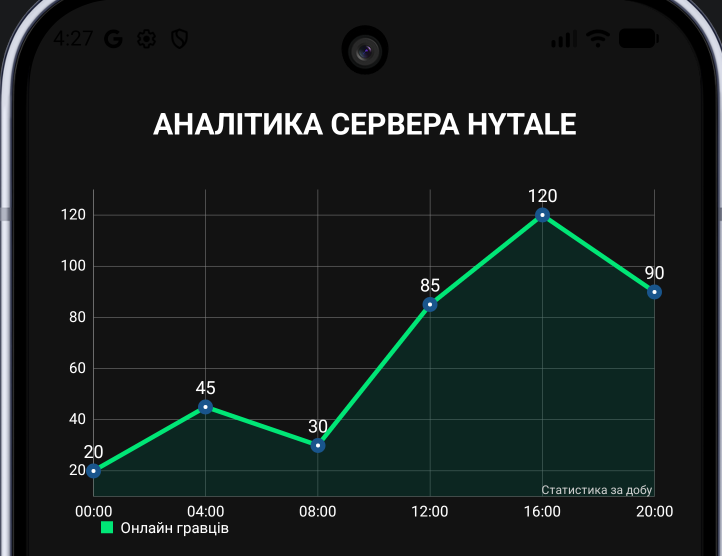
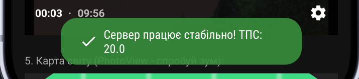
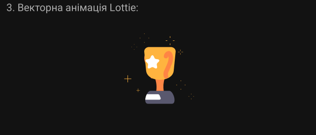
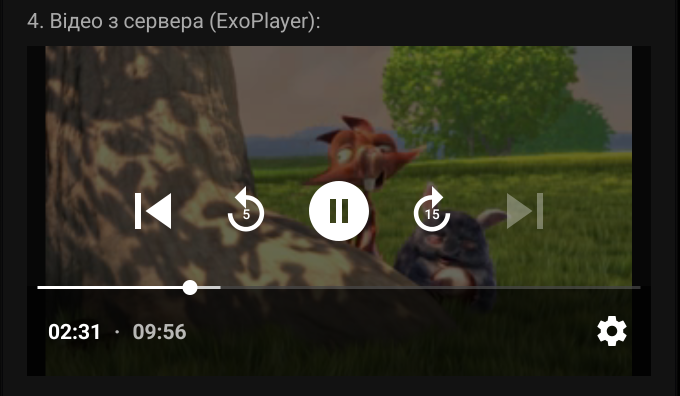
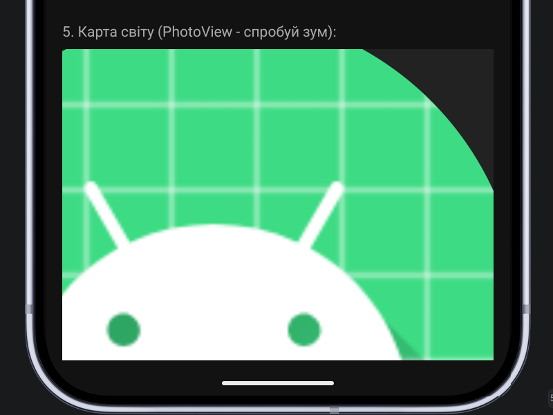

## Бібліотеки
1. **[MPAndroidChart](https://github.com/PhilJay/MPAndroidChart)** (v3.1.0) 
   * **Призначення:** Побудова інтерактивних графіків.
   * **Реалізація:** Відображення динамічного графіка ТПС та онлайну гравців за добу. Підтримує анімацію побудови осі X та масштабування (Pinch-to-zoom) пальцями.

2. **[Toasty](https://github.com/GrenderG/Toasty)** (v1.5.2)
   * **Призначення:** Кастомні кольорові Toast-сповіщення.
   * **Реалізація:** Виведення інформаційних плашок про успішну перевірку статусу сервера (із вбудованими іконками замість системних сірих повідомлень).

3. **[Lottie for Android](https://github.com/airbnb/lottie-android)** (v6.4.0)
   * **Призначення:** Рендеринг складної векторної анімації (Adobe After Effects).
   * **Реалізація:** Анімація статусу роботи вузла з використанням локального `.json` файлу в папці `res/raw/`.

4. **[Media3 / ExoPlayer](https://github.com/androidx/media)** (v1.3.0)
   * **Призначення:** Сучасний рушій від Google для відтворення відео та аудіо.
   * **Реалізація:** Інтеграція `PlayerView` для потокового перегляду тестових відеозаписів геймплею із збереженням життєвого циклу Activity (`onStop`, `onDestroy`).

5. **[PhotoView](https://github.com/Baseflow/PhotoView)** (v2.3.0)
   * **Призначення:** `ImageView` з підтримкою жестів зумування.
   * **Реалізація:** Перегляд загальної мапи ігрового континенту з можливістю детального наближення (подвійний тап та pinch-to-zoom).

| Головний екран та графік | Сповіщення Toasty |
| :---: | :---: |
|  |  |

| Lottie | ExoPlayer |
| :---: | :---: |
|  |  |

| Зум карти у PhotoView |
| :---: |
|  |
